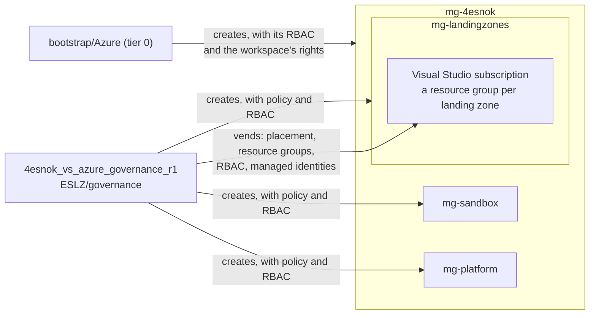

<!-- AI agent: do not modify this file unless explicitly requested by the user. -->
# Governance

This module manages:

- Management groups and RBAC on them
- Azure Policy
- Subscription vending: resource groups, RBAC, managed identities, budgets

It uses:
 - azure/avm-ptn-alz
 - azure/avm-ptn-alz-sub-vending


## config.yaml schema

```yaml
entraid_tenant_id: <tenant ID>         # required; its tenant root group is the parent of the hierarchy, and the plan
                                       # fails when signed in to another tenant
alz_library_references:                # required; ALZ libraries the alz provider loads
  - custom_url: <dir>                  # a local library, relative to ESLZ/governance ...
  - path: <library path>               # ... or one from Azure-Landing-Zones-Library, e.g. platform/alz
    ref: <release>                     # with path
management_groups:
  architecture: <name>                 # required; the hierarchy, <name>.alz_architecture_definition.yaml in a library
  location: <region>                   # required; for policy managed identities
  policy_default_values:               # optional; assignment parameters set here
    <default name>: <value>            # e.g. allowed_locations: [<region>, ...]
  role_assignments:                    # optional; assignments at groups created outside this module
    <management group>:                # e.g. mg-landingzones
      - role: <role>                   # required; built-in role name
        group: <display name>          # a security group ...
        principal_id: <object ID>      # ... or an object ID
        principal_type: User | Group | ServicePrincipal  # with principal_id
        condition: <ABAC condition>    # optional
```

- `architecture`: each group's `id`, `display_name`, `parent_id` and `archetypes`. `mg-4esnok` is `exists: true`:
  tier 0 creates it, and this workspace only gives it its archetype.
- `policy_default_values`: keys are the default names in `alz-lib/alz_policy_default_values.json`, and each sets the
  parameters mapped to that name. `allowed_locations` is the regions `Deny-Resource-Locations` allows.


## Subscriptions

Subscription vending, as CAF describes it. Each file in `subscriptions/` is a landing zone, and sets its:
- management group
- resource providers and preview features
- budgets
- resource groups, optionally locked
- user-assigned managed identities for workloads, with their role assignments
- role assignments on the subscription and its resource groups

There is only one subscription, the Visual Studio one, so all landing zones share it. Each landing zone's resource
group stands in for the subscription it would have, and its pipeline gets roles on that resource group only.

Settings for the whole subscription go in only one file per `subscription_id`: `display_name`, `tags`,
`management_group_id`, `role_assignments`, and budgets without a `resource_group`. If two files set them, the plan
fails. `resource_providers` is the exception: every file lists the providers its stack deploys, because the landing
zone's pipeline can't register them itself. To move a landing zone to its own subscription, change its
`subscription_id` and add the subscription's settings to its file.

```yaml
subscription_id: <GUID>                # required, lowercase
location: <region>                     # required; also for resource groups without a location
display_name: <name>                   # renames the subscription when it differs; also needed for tags
tags: { <key>: <value> }               # merged into the subscription's tags; tags removed here stay
management_group_id: <group>           # a group of the hierarchy, e.g. mg-landingzones
resource_providers:                    # registered, never unregistered
  <namespace>: [<preview feature>]
budgets:
  <name>:
    amount: <number>                   # required
    start_date: <YYYY-MM-01>           # required; the first day of a month
    end_date: <YYYY-MM-DD>             # default 10 years after start_date
    time_grain: Monthly                # default
    resource_group: <name>             # a resource group of this file; default the subscription
    notifications:
      - threshold: <percent>           # required
        threshold_type: Actual | Forecasted               # default Actual
        operator: GreaterThan | GreaterThanOrEqualTo      # default GreaterThan
        contact_emails: [<email>]
        contact_roles: [<role>]        # default [Owner]
role_assignments:                      # at subscription scope
  - role: <role>                       # required; built-in role name
    group: <display name>              # a security group ...
    service_principal: <display name>  # ... a service principal ...
    principal_id: <object ID>          # ... or an object ID
    principal_type: User | Group | ServicePrincipal       # with principal_id
    condition: <ABAC condition>        # optional
resource_groups:
  <name>:
    location: <region>                 # default the file's location
    tags: { <key>: <value> }
    lock: true | false                 # CanNotDelete lock; default false
    role_assignments: [...]            # as above, at resource group scope
managed_identities:                    # user-assigned, for workloads whose pipelines cannot assign roles
  <name>:
    resource_group: <name>             # required; a resource group of this file
    role_assignments:
      - role: <role>                   # required; built-in role name
        resource_group: <name>         # on a resource group of this file ...
        scope: /resourceGroups/<...>   # ... or a resource, by its ID relative to the subscription; neither: the subscription
```


**Add a landing zone:** add `subscriptions/<name>.yaml` with `subscription_id`, `location` and its resource groups.
For a workload, see [Adding a workload](../workloads/README.md#adding-a-workload).


## Diagram


