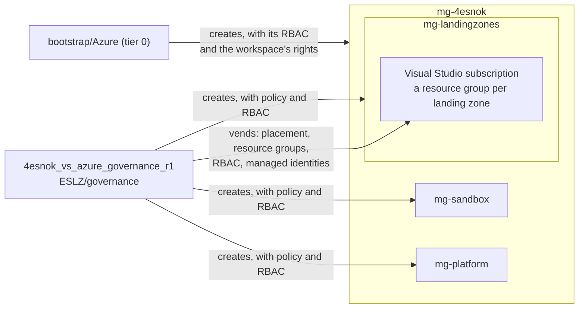

# Governance

The management groups below the intermediate root `mg-4esnok`, with Azure Policy and Azure RBAC on them, built with
the Azure Verified Module for Azure Landing Zones
([`Azure/avm-ptn-alz`](https://registry.terraform.io/modules/Azure/avm-ptn-alz/azurerm)) through
[modules/azure-management-groups](../../modules/azure-management-groups/main.tf), and the subscriptions in them,
configured by [subscription vending](#subscriptions). The HCP Terraform workspace `4esnok_vs_azure_governance_r1`
applies it when a change is merged to `main`.

`mg-4esnok`, its Azure RBAC and the tenant's hierarchy settings are tier 0
([bootstrap/Azure](../../bootstrap/Azure/README.md)). Tier 0 also creates this workspace's identity,
`sp-prd-az-mg4esnok-owner-hcp-workspace-t1`, and gives it Owner on `mg-4esnok`.


## config.yaml schema

```yaml
entraid_tenant_id: <tenant ID>         # required; its tenant root group is the parent of the hierarchy, and the plan
                                       # fails when signed in to another tenant
alz_library_references:                # required; ALZ libraries the alz provider loads
  - custom_url: <dir>                  # a local library, relative to ESLZ/governance ...
  - path: <library path>               # ... or one from Azure-Landing-Zones-Library, e.g. platform/alz
    ref: <release>                     # with path
management_groups:
  architecture: <name>                 # required; the hierarchy, <name>.alz_architecture_definition.yaml in a library
  location: <region>                   # required; for policy managed identities
  policy_default_values:               # optional; assignment parameters set here
    <default name>: <value>            # e.g. allowed_locations: [<region>, ...]
  role_assignments:                    # optional
    <management group>:                # e.g. mg-landingzones
      - role: <role>                   # required; built-in role name
        group: <display name>          # a security group ...
        principal_id: <object ID>      # ... or an object ID
        principal_type: User | Group | ServicePrincipal  # with principal_id
        condition: <ABAC condition>    # optional
```

- `architecture`: each group's `id`, `display_name`, `parent_id` and `archetypes`. `mg-4esnok` is `exists: true`:
  tier 0 creates it, and this workspace only gives it its archetype.
- `policy_default_values`: keys are the default names in `alz-lib/alz_policy_default_values.json`, and each sets the
  parameters mapped to that name. `allowed_locations` is the regions `Deny-Resource-Locations` allows.
- `role_assignments`: subscriptions below a management group inherit its role assignments. Groups are looked up in
  Entra ID by display name, so they must exist before the plan ([entraid](../../entraid/README.md) creates them).


## Policy

A few of the policies that CAF recommends, chosen to cost nothing and not get in the way of lab work. Each group has
one archetype from `alz-lib/`:

| Group | Assignment | Effect | |
|---|---|---|---|
| `mg-4esnok` | `Audit-ResourceRGLocation` | Audit | Resources in a different region from their resource group |
| | `Deny-UnmanagedDisk` | Audit | Virtual machines without managed disks |
| | `Deny-Classic-Resources` | Deny | Classic (ASM) resource types |
| | `Deny-Resource-Locations` | Deny | Regions not in `allowed_locations`; global resources are allowed |
| | `Deploy-SvcHealth-BuiltIn` | DeployIfNotExists | A service health alert in each subscription, in `rg-serviceHealthAlert`, notifying its Owners |
| `mg-landingzones` | `Deny-Storage-http` | Deny | Storage accounts that accept HTTP |
| `mg-sandbox` | `Enforce-ALZ-Sandbox` | Deny | Hybrid connectivity resources and VNet peering to other subscriptions |
| `mg-platform` | none | | |

All but `Deny-Resource-Locations` come from the Azure Landing Zones reference library, `platform/alz`, which
`alz_library_references` loads at a pinned release. An archetype names the assignments, and the definitions it needs,
that it takes from there. Only what an archetype lists is created, so the rest of the reference library isn't deployed.
ALZ policies that need Log Analytics, Defender for Cloud plans or a DDoS plan are left out, as are Denies that would
block common experiments, such as `Deny-IP-forwarding` and `Deny-Subnet-Without-Nsg`.

Policy comes from `alz-lib/`, a custom [Azure Landing Zones library](https://github.com/Azure/Azure-Landing-Zones-Library)
that the module assigns with the hierarchy:

| Path | Contents |
|---|---|
| `<architecture>.alz_architecture_definition.yaml` | The hierarchy and each group's archetypes |
| `archetype_definitions/*.alz_archetype_definition.json` | Archetypes: the policy assignments, definitions and role definitions a group gets |
| `policy_assignments/*.alz_policy_assignment.json` | Policy assignments; the module sets scope and location |
| `policy_definitions/*.alz_policy_definition.json` | Custom policy definitions, created on the group of the archetype that lists them |
| `alz_policy_default_values.json` | Default names for assignment parameters whose values are set in `policy_default_values` |

**Add a policy:**

1. Use an assignment from [`platform/alz`](https://github.com/Azure/Azure-Landing-Zones-Library/tree/main/platform/alz/policy_assignments)
   by name, or add one to `policy_assignments/`, with a name of at most 24 characters, and a custom definition to
   `policy_definitions/`.
2. List them in an archetype, and give the group that archetype instead of `empty`.
3. A parameter whose value is set in `config.yaml`, such as the allowed regions or a Log Analytics workspace ID from
   another stack, keeps a placeholder in the assignment and gets a default name in `alz_policy_default_values.json`.
   The module sets it from `policy_default_values`.

DeployIfNotExists and Modify assignments get a system-assigned identity. The module grants it the roles from the
definition, at the group and on resources passed in parameters marked `assignPermissions`. Policy acts only on
resources created or changed after the assignment; for existing ones, such as the service health alert in a
subscription that was already in the hierarchy, create a remediation task:

```sh
az policy remediation create --management-group <group> --policy-assignment <assignment> -n <name>
```


## Subscriptions

Subscription vending as CAF describes it: each file in `subscriptions/` is a landing zone, configured by the Azure
Verified Module [`Azure/avm-ptn-alz-sub-vending`](https://registry.terraform.io/modules/Azure/avm-ptn-alz-sub-vending/azure)
through [modules/azure-subscription-vending](../../modules/azure-subscription-vending/main.tf): management group,
resource providers and preview features, budgets, resource groups (optionally locked), user-assigned managed
identities for workloads with their role assignments, and role assignments at subscription and resource group
scope. Subscriptions are never created or cancelled here.

There is one subscription, the Visual Studio one, so the landing zones share it. Each one's resource group stands
in for the subscription it would have, and its pipeline gets roles on that resource group only:

| File | Landing zone | As a subscription of its own |
|---|---|---|
| `admin-4esnok-su-vs.yaml` | The subscription itself: management group, users' access | |
| `platform-management.yaml` | `rg-mgmt-dev-nzn-01`, [management](../management/README.md) | in `mg-platform` |
| `platform-connectivity.yaml` | `rg-connectivity-dev-nzn-01`, [connectivity](../connectivity/README.md) | in `mg-platform` |
| `landingzone-cortex.yaml` | `rg-cortex-dev-nzn-01` and its managed identities, [cortex](../workloads/cortex/README.md) | in `mg-landingzones` |

One file per `subscription_id` holds the settings of the whole subscription: `display_name`, `tags`,
`management_group_id`, `role_assignments` and budgets without `resource_group`. The plan fails when two files set
them. `resource_providers` can be in every file: a landing zone lists what its stack deploys, as its pipeline
cannot register providers. To give a landing zone a subscription of its own, change its `subscription_id`, and give
the file the subscription's settings.

```yaml
subscription_id: <GUID>                # required, lowercase
location: <region>                     # required; also for resource groups without a location
display_name: <name>                   # renames the subscription when it differs; also needed for tags
tags: { <key>: <value> }               # merged into the subscription's tags; tags removed here stay
management_group_id: <group>           # a group of the hierarchy, e.g. mg-landingzones
resource_providers:                    # registered, never unregistered
  <namespace>: [<preview feature>]
budgets:
  <name>:
    amount: <number>                   # required
    start_date: <YYYY-MM-01>           # required; the first day of a month
    end_date: <YYYY-MM-DD>             # default 10 years after start_date
    time_grain: Monthly                # default
    resource_group: <name>             # a resource group of this file; default the subscription
    notifications:
      - threshold: <percent>           # required
        threshold_type: Actual | Forecasted               # default Actual
        operator: GreaterThan | GreaterThanOrEqualTo      # default GreaterThan
        contact_emails: [<email>]
        contact_roles: [<role>]        # default [Owner]
role_assignments:                      # at subscription scope
  - role: <role>                       # required; built-in role name
    group: <display name>              # a security group ...
    service_principal: <display name>  # ... a service principal ...
    principal_id: <object ID>          # ... or an object ID
    principal_type: User | Group | ServicePrincipal       # with principal_id
    condition: <ABAC condition>        # optional
resource_groups:
  <name>:
    location: <region>                 # default the file's location
    tags: { <key>: <value> }
    lock: true | false                 # CanNotDelete lock; default false
    role_assignments: [...]            # as above, at resource group scope
managed_identities:                    # user-assigned, for workloads whose pipelines cannot assign roles
  <name>:
    resource_group: <name>             # required; a resource group of this file
    role_assignments:
      - role: <role>                   # required; built-in role name
        resource_group: <name>         # on a resource group of this file ...
        scope: /resourceGroups/<...>   # ... or a resource, by its ID relative to the subscription; neither: the subscription
```

- Principals are looked up in Entra ID by name, so they must exist before the plan. The workspace's application
  reads groups and service principals (`Group.Read.All` and `Application.Read.All`, from tier 0). Users get access
  through groups.
- A managed identity that joins a subnet is a consumer of it in [connectivity](../connectivity/README.md), which
  looks it up by name: this workspace applies first.

**Add a landing zone:** add `subscriptions/<name>.yaml` with `subscription_id`, `location` and its resource groups.
For a workload, see [Adding a workload](../workloads/README.md#adding-a-workload).

**Add a subscription:** this workspace has Owner on `mg-4esnok`, but no rights on a subscription outside it. The
subscription's Owner moves it into the hierarchy once, which also needs write access on the target group:

```sh
az account management-group subscription add --name <management group> --subscription <subscription ID>
```

Then add its file with the same `management_group_id`. From then on, this workspace keeps it there.

Caveats:

- **Blast radius:** vending shares this workspace and its state with the hierarchy and policy, whereas CAF keeps
  it separate. A file that fails, for example one naming a missing group, stops every plan here, policy changes
  included.
- **Deletes:** removing a resource group, or its file, deletes it and everything in it when the change is merged,
  unless it has `lock: true`. Removing a role assignment or a managed identity deletes it. Renaming a file
  recreates its resource groups.
- **Existing objects are not imported:** declaring a resource group or budget that already exists fails with
  "already exists", and a role assignment created outside Terraform conflicts (`RoleAssignmentExists`, as the
  module names assignments by a GUID derived from scope, principal and role). Delete it first, or leave it out.
- **Renames outside Terraform** are not detected; the rename runs again only when `display_name` changes.
- **Telemetry** of the module is off (`enable_telemetry = false`).


## Diagram


