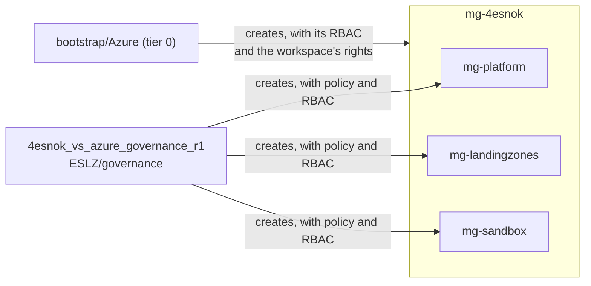

# Governance

The management groups below the intermediate root `mg-4esnok`, with Azure Policy and Azure RBAC on them, built with
the Azure Verified Module for Azure Landing Zones
([`Azure/avm-ptn-alz`](https://registry.terraform.io/modules/Azure/avm-ptn-alz/azurerm)) through
[modules/azure-management-groups](../../modules/azure-management-groups/main.tf). The HCP Terraform workspace
`4esnok_vs_azure_governance_r1` applies it when a change is merged to `main`.

`mg-4esnok`, its Azure RBAC and the tenant's hierarchy settings are tier 0
([bootstrap/Azure](../../bootstrap/Azure/README.md)). Tier 0 also creates this workspace's identities,
`sp-hcp-azure-governance-r1-plan` and `-apply`, and gives them their rights on `mg-4esnok`.


## config.yaml schema

```yaml
entraid_tenant_id: <tenant ID>         # required; its tenant root group is the parent of the hierarchy, and the plan
                                       # fails when signed in to another tenant
alz_library_references:                # required; ALZ libraries the alz provider loads
  - custom_url: <dir>                  # a local library, relative to ESLZ/governance ...
  - path: <library path>               # ... or one from Azure-Landing-Zones-Library, e.g. platform/alz
    ref: <release>                     # with path
management_groups:
  architecture: <name>                 # required; the hierarchy, <name>.alz_architecture_definition.yaml in a library
  location: <region>                   # required; for policy managed identities
  role_assignments:                    # optional
    <management group>:                # e.g. mg-landingzones
      - role: <role>                   # required; built-in role name
        group: <display name>          # a security group ...
        principal_id: <object ID>      # ... or an object ID
        principal_type: User | Group | ServicePrincipal  # with principal_id
        condition: <ABAC condition>    # optional
```

- `architecture`: each group's `id`, `display_name`, `parent_id` and `archetypes`. `mg-4esnok` is `exists: true`:
  tier 0 creates it, and this workspace only gives it its archetype.
- `role_assignments`: subscriptions below a management group inherit its role assignments. Groups are looked up in
  Entra ID by display name, so they must exist before the plan ([entraid](../../entraid/README.md) creates them).

Subscriptions are not moved here, as that needs Owner on the subscription. Its Owner moves it, with Management
Group Contributor on `mg-4esnok` from `role_assignments`:

```sh
az account management-group subscription add --name <management group> --subscription <subscription ID>
```


## Policy

No policy is assigned yet: every group has the alz provider's built-in `empty` archetype.

Policy comes from `alz-lib/`, a custom [Azure Landing Zones library](https://github.com/Azure/Azure-Landing-Zones-Library)
that the module assigns with the hierarchy:

| Path | Contents |
|---|---|
| `<architecture>.alz_architecture_definition.yaml` | The hierarchy and each group's archetypes |
| `archetype_definitions/*.alz_archetype_definition.json` | Archetypes: the policy assignments, definitions and role definitions a group gets |
| `policy_assignments/*.alz_policy_assignment.json` | Policy assignments; the module sets scope and location |
| `policy_definitions/*.alz_policy_definition.json` | Custom policy definitions, created on the group of the archetype that lists them |
| `alz_policy_default_values.json` | Default names for assignment parameters whose values are set in Terraform |

**Add a policy:**

1. Add the assignment to `policy_assignments/`, with a name of at most 24 characters, and a custom definition to
   `policy_definitions/`.
2. List them in an archetype, and give the group that archetype instead of `empty`.
3. A parameter whose value comes from another stack, such as a Log Analytics workspace ID, keeps a placeholder in the
   assignment and gets a default name in `alz_policy_default_values.json`. The module sets it from
   `policy_default_values`, which isn't passed in yet.

DeployIfNotExists and Modify assignments get a system-assigned identity. The module grants it the roles from the
definition, at the group and on resources passed in parameters marked `assignPermissions`. Policy acts only on
resources created or changed after the assignment; for existing ones, create a remediation task:

```sh
az policy remediation create --management-group <group> --policy-assignment <assignment> -n <name>
```


## Diagram


