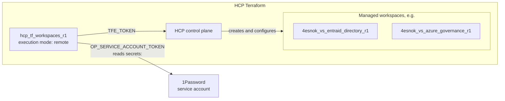

# HCP Terraform: projects and workspaces (tier 1)

Day-two management of HCP Terraform projects and workspaces. 

The hcp workspace which applies this configuration are created by [bootstrap/HCP](../bootstrap/HCP/README.md).

## config.yaml schema

```yaml
organization: <name>                    # required
runner_workspace: <name>                # optional; the workspace that runs this file, see below
projects:
  <project>:
    description: <text>                 # optional
    variable_sets:                      # optional; env vars for every workspace in the project, literal values only
      - name: <name>                    # required, unique in the organization
        description: <text>             # optional
        variables: { <ENV>: <value> }
    workspaces:
      <workspace>:
        description: <text>             # optional
        execution_mode: remote | local  # default remote
        auto_apply: true | false        # default false; applies to API, UI, VCS and run-trigger runs
        terraform_version: <version>    # default HCP's latest for new workspaces; existing ones keep theirs
        tags: { <key>: <value> }        # optional
        vcs:                            # optional; omit for local or CLI-driven runs
          repo: <owner>/<repo>          # required
          github_app_installation: <account>  # required; GitHub account or organization of the App installation
          working_directory: <path>     # optional; default repository root
          branch: <branch>              # default main
          trigger_patterns: [<glob>]    # default /<working_directory>/**/*
        variables:                      # optional; env vars, see Workspace variables
          <ENV>: <value> | tfe://<workspace>/<output>[/<key>]
        secrets:                        # optional; sensitive env vars read from 1Password
          <ENV>: op://<vault>/<item>/<field>
        remote_state:                   # default not shared
          share_with: organization | project | workspaces
          workspaces: [<workspace>]     # only with share_with: workspaces
        auto_destroy:                   # optional; set exactly one field
          after_inactivity: <n>d | <n>h # after the last run
          at: <RFC3339 time>            # e.g. "2026-10-31T18:00:00Z"
```

- `runner_workspace`: the name of the HCP workspace that use this configuration file (terraform doesn't know its own namespace). This workspace name is used to create run triggers for workspaces that read outputs. e.g. if `hcp_tf_workspaces_r1` reads APP IDs from outputs of `4esnok_vs_azure_bootstrap_r0`. see [Workspace variables and secrets](#workspace-variables) below.

- `variable_sets` is project wide variables, which are applied to every workspace in the project.

> [!WARNING]
> `auto_destroy` needs an HCP Terraform **Standard or Plus** organization. On the Free plan, HCP accepts the setting
> without an error but does not store it, so nothing is destroyed and every plan shows the same update again.

### Workspace variables and secrets

- `variables` maps environment variable names to values. A value of the form `tfe://<workspace>/<output>` or
`tfe://<workspace>/<output>/<key>` is read from that workspace's output. Any other value is set as it is. E.g. This is how a workspace gets the client IDs of the Entra ID applications it signs in as
(see [HCP Terraform integration](../bootstrap/Azure/README.md#hcp-terraform-integration)):
```yaml
    variables:
      TF_VAR_tenant: 4esnok_vs
      TFC_AZURE_PLAN_CLIENT_ID: tfe://4esnok_vs_azure_bootstrap_r0/client_ids/sp-hcp-entraid-directory-r1-plan
      TFC_AZURE_APPLY_CLIENT_ID: tfe://4esnok_vs_azure_bootstrap_r0/client_ids/sp-hcp-entraid-directory-r1-apply
```

- `secrets` works similarly, but the values are read from 1Password. In case tier1, the workspace has a OP token to access the vault.

## Diagram

