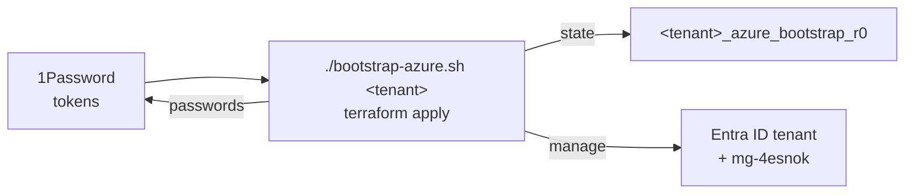

# Entra ID tenant bootstrap (tier 0)


This directory contains the bootstrap of each Entra ID tenant.

It is run manually, when bootstrapping a new tenant or making fundamental changes.

It creates the admin and break-glass users, the tier-0 groups, the identities of the HCP workspaces that manage the
tenant and, for a tenant with Azure, the intermediate root management group `mg-4esnok`. All day-two operations are
done in [tier 1](../../entraid/README.md).


## Prerequisites

- HCP: workspace `<tenant>_azure_bootstrap_r0`, with execution mode **Local**. *[HCP/config.yaml](../../HCP/config.yaml)*
- 1Password: vaults and tokens - see config file for details. *./bootstrap-azure.sh*


## Bootstrap a tenant (manual steps)

1. **Sign in** as a Global Administrator: `az login --tenant <tenant ID> --allow-no-subscriptions`.

1. **Azure only: get Hierarchy Settings Administrator** on the tenant root group. Turn on **Entra ID → Properties →
   Access management for Azure resources**, then assign yourself the role.

1. **Apply tier 0.**
   ```sh
   ./bootstrap-azure.sh <tenant> init
   ./bootstrap-azure.sh <tenant> apply
   ```

1. **Azure only: remove the role** and turn access management off again.

1. **Apply [HCP tier 1](../../HCP/README.md)**, to pass the new client IDs to the workspaces.



