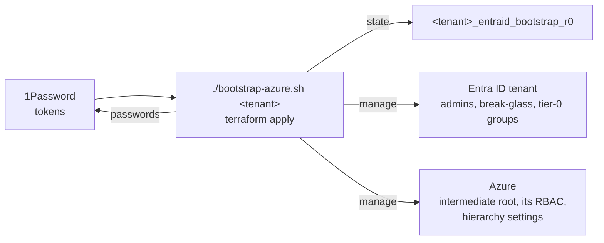

# Entra ID tenant bootstrap (tier 0)


This directory contains the bootstrap of each Entra ID tenant: its admin and break-glass users, tier-0 groups
(`sg-t0-*`) and the identities of the HCP Terraform workspaces that manage the tenant (see
[HCP Terraform integration](#hcp-terraform-integration)). For a tenant with Azure subscriptions, it also creates the intermediate root management group, the
Azure RBAC on it and the tenant's management group hierarchy settings (see [Intermediate root](#intermediate-root)).

It is run manually by a Global Administrator, when bootstrapping a new tenant or making fundamental changes. Users
are created with passwords stored in 1Password.

All day-two changes (other users and groups, applications, Conditional Access, management groups, ...) are done in
[tier 1](../../entraid/README.md), which cannot name tier-0 users. Both tiers use the
shared module [`modules/entraid-tenant`](../../modules/entraid-tenant) and the same `entra_id` config schema,
described in the [tier-1 README](../../entraid/README.md#tenant-config-reference).

Each tenant is a separate Terraform root with its own HCP workspace, named in its `cloud` block, so one tenant's
config can never be planned against another tenant's state.

```
bootstrap-azure.sh         ./bootstrap-azure.sh <tenant> init|plan|apply
<tenant>/
  terraform.tf             cloud block (workspace <tenant>_entraid_bootstrap_r0), shared modules
  config.yaml              the tenant's tier-0 config
```


## Prerequisites

- Terraform CLI, Azure CLI
- 1Password CLI, with access to the `IT` vault (tokens) and the vaults that store user passwords (`password.onepassword_vault`)
- HCP: workspace `<tenant>_entraid_bootstrap_r0` in project `<tenant>_r0`, with execution mode **Local**,
  created by [HCP tier 1](../../HCP/config.yaml)


## Bootstrap a tenant

1. **Sign in** as a Global Administrator of the tenant: `az login --tenant <tenant ID> --allow-no-subscriptions`.

1. **Tenants with Azure: get rights on the tenant root group**, needed for the hierarchy settings. In the portal,
   turn on **Entra ID → Properties → Access management for Azure resources**, then sign in again with `az login`
   and assign yourself the role:
   ```sh
   az role assignment create --assignee <your object ID> --role "Hierarchy Settings Administrator" \
     --scope /providers/Microsoft.Management/managementGroups/<tenant ID>
   ```

1. **Apply tier 0.**
   ```sh
   ./bootstrap-azure.sh 4esnok_vs init
   ./bootstrap-azure.sh 4esnok_vs apply
   ```
   The plan fails if the signed-in tenant is not the config's `entraid_tenant_id`.

1. **Tenants with Azure: remove the rights again**: delete the role assignment from the previous step and turn
   **Access management for Azure resources** off.

1. **Set up the break-glass accounts**, see [Break-glass accounts](../../entraid/README.md#break-glass-accounts).

1. **Apply tier 1**, see [entraid](../../entraid/README.md#day-two-operations).



### Add a tenant

1. Copy an existing tenant directory to `<tenant>/`. In `terraform.tf`, set the workspace name to
   `<tenant>_entraid_bootstrap_r0`. In `config.yaml`, set the tenant's `entraid_tenant_id`, admin and break-glass
   `users` and `sg-t0-*` groups. For a tenant without Azure, remove `management_groups` from `config.yaml`, and the
   `intermediate_root_management_group` module from `terraform.tf` (as in `4esnok_mail`).
2. Add workspace `<tenant>_entraid_bootstrap_r0` in project `<tenant>_r0` to [HCP/config.yaml](../../HCP/config.yaml).
3. Bootstrap it as above, then add it to [tier 1](../../entraid/README.md#add-a-tenant).

The directory name is the tenant name, the prefix of its HCP project and workspace names. It must
match the tenant's directory in [entraid/tenants](../../entraid/tenants).


## Intermediate root

Following the Cloud Adoption Framework, a tenant's management groups hang from one intermediate root (`mg-4esnok`)
below the tenant root group, which gets no policy or role assignments itself. Tier 0 creates only that group, from
`management_groups` in the tenant config with the shared module
[`modules/azure-intermediate-root-management-group`](../../modules/azure-intermediate-root-management-group), with
Azure RBAC for three groups (role assignments take an optional ABAC `condition`):

| Group | Roles on the intermediate root | Members |
|---|---|---|
| `sg-prd-az-root-owner-t0` | Owner | none standing; add someone only for a change that needs it |
| `sg-prd-az-root-mgmt-t0` | Contributor, Resource Policy Contributor, Role Based Access Control Administrator (can't assign or remove Owner or User Access Administrator) | tier-1 apply runs: management groups, policy and role assignments below |
| `sg-prd-az-root-reader-t0` | Reader | `sysadmin`, tier-1 plan runs |

Every group and subscription below inherits these. Tier 0 also sets the tenant's hierarchy settings: new
subscriptions go to the intermediate root instead of the tenant root group, and `require_authorization_for_group_creation`
makes creating a management group require write access on its parent. These settings replace any the tenant already
has, and are removed with the intermediate root.

The groups below the intermediate root, their policy and their role assignments are in
[tier 1](../../entraid/README.md#management-groups), where the intermediate root is marked `exists: true`.


## HCP Terraform integration

HCP Terraform runs sign in to Azure and Microsoft Graph with dynamic credentials (OIDC): each workspace has a plan
and an apply application, `sp-hcp-<workspace>-<plan|apply>`, with a federated credential for that run phase.
Tier 0 creates them for the workspaces that manage the tenant itself (`entraid`, ESLZ/management); tier 1 creates
them for the other workspaces.

Two settings of an application connect it to workspaces:

- `federated_credentials`: lets the runs of a workspace sign in as the application. The subject names the workspace
  and run phase, `organization:<org>:project:<project>:workspace:<workspace>:run_phase:<plan|apply>`.
- `hcp_workspaces`: writes the application's client ID to each listed workspace (with `hcp_organization` at the top
  of the tenant config), as `TFC_AZURE_PLAN_CLIENT_ID` or `TFC_AZURE_APPLY_CLIENT_ID` for its `run_phase`, or
  `TFC_AZURE_RUN_CLIENT_ID` for both phases. Applied by
  [`modules/hcp-workspace-identity`](../../modules/hcp-workspace-identity).

One application can serve several workspaces: list each in both settings. The values that survive a rebuild,
`TFC_AZURE_PROVIDER_AUTH` and `ARM_TENANT_ID`, are in the project's variable set, from
[HCP/config.yaml](../../HCP/config.yaml) (`variable_sets` of the project). Nothing is copied by hand, so the landing zone can
be rebuilt from scratch in one pass:

1. [bootstrap/HCP](../HCP/README.md), then [HCP](../../HCP/README.md): projects, workspaces and their variable sets.
2. Tier 0 (this directory): its applications and their workspace variables. The workspaces must exist first.
3. [Tier 1](../../entraid/README.md): its applications and their workspace variables.
4. The ESLZ workspaces, whose first run signs in with the new applications.

The scripts give the `tfe` provider the HCP token they already read (`TFE_TOKEN`). Tier 0 runs locally with the
Azure CLI login, and HCP Terraform only stores its state.

### Tier 1

For tier 1 of `4esnok_vs` (workspace `4esnok_vs_entraid_mgmt_r1`) to run in HCP Terraform, tier 0 creates:

- its plan and apply applications, with their Graph permissions and client IDs on the workspace;
- their Azure rights on the intermediate root (see [Intermediate root](#intermediate-root));

The workspace's execution mode and VCS connection are in [HCP/config.yaml](../../HCP/config.yaml). Its other
variables are set by hand in HCP Terraform, see [Remote runs](../../entraid/README.md#remote-runs). The apply
application can grant itself any directory role (`RoleManagement.ReadWrite.Directory`), so it can reach anything in
the tenant: protect the workspace like tier 0.
