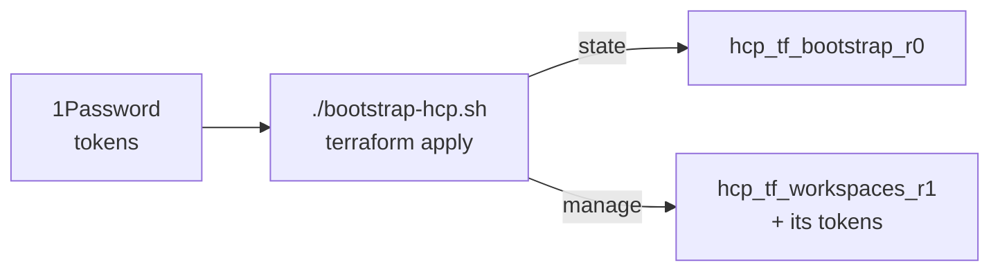

# HCP Terraform bootstrap (tier 0)


This directory contains the bootstrap of HCP Terraform.

It is run manually, when bootstrapping a new account or making fundamental configuration changes.

It sets up the [tier-1 workspace](../../HCP/README.md), which manages the HCP Terraform configuration from version control,
GitOps style: changes are merged to `main` and applied automatically. All day-two operations (e.g. creating a new
workspace) are done in tier 1.


## Prerequisites

Create/update the following resources manually:

- HCP: workspace `hcp_tf_bootstrap_r0` in HCP Terraform, with execution mode **Local**.
- HCP: user tokens for tier 0 and tier 1, stored in 1Password.
- 1Password: vaults and tokens - see config file for details.


## Bootstrap a new HCP account (manual steps)

1. **Create the organization.** Register an HCP account at https://portal.cloud.hashicorp.com, then sign in at https://app.terraform.io and create the organization.

1. **Create the tier-0 workspace.** Create workspace `hcp_tf_bootstrap_r0` and set its execution mode to **Local**.

1. **Connect GitHub.** Go to **Workspaces → tier-0 → Version Control Workflow → GitHub.com**.

1. **Create tokens.** Click your avatar → **Account settings → Tokens → Create an API token**. Save them in 1Password.

1. **Apply tier 0.**
   ```sh
   ./bootstrap-hcp.sh init
   ./bootstrap-hcp.sh apply
   ```





