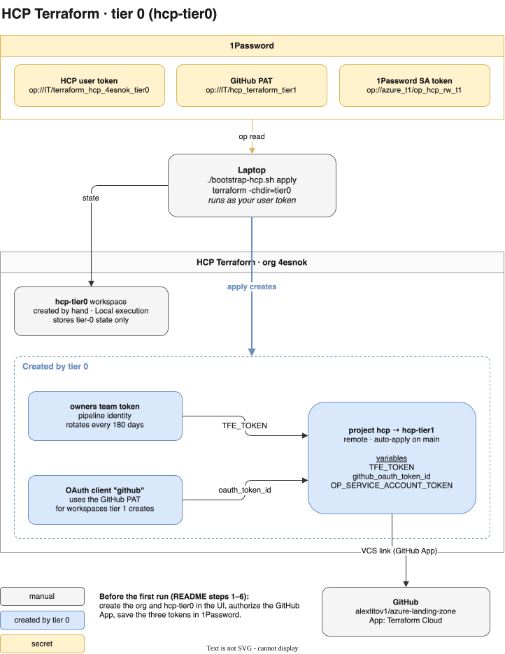

# HCP Terraform bootstrap (tier 0)

To add or change projects and workspaces, see [HCP](../../HCP/README.md) (tier 1).

TODO: consider alternatives e.g. Terrakube

This directory contains the tier-0 bootstrap of HCP (HashiCorp Cloud Platform) Terraform.

HCP Terraform is used as the backend for the Terraform state files of the deployments in this repository. 
Where it's possible, HPC workspaces are integrated with GitHub, 1Password and Azure, which makes it possible to deploy with a single commit to to the main branch.

## Prerequisites

- HCP (Free Tier is sufficient, except for `auto_destroy`, which needs Standard or Plus)
- 1Password for storing secrets


## Introduction

There are two deployments that work the same way: each creates the projects and workspaces listed in its
`config.yaml` with the shared module `modules/hcp-projects`. They differ only in where they run and how privileged they are.
Tier 0 runs locally with your user token and your own 1Password access, and creates tier 1. Tier 1 runs in HCP on merge
to `main`, with its own user token and a 1Password service account limited to the `azure_t1` vault.

| Tier | Workspace | Created by | Runs | Manages |
|------|-----------|------------|------|---------|
| 0 | `hcp_tf_bootstrap_r0` | Manually, in the UI | Locally, with your user token | The projects and workspaces in `bootstrap/HCP/config.yaml`: `hcp_tf_workspaces_r1` |
| 1 | `hcp_tf_workspaces_r1` | Tier 0 | In HCP, on merge to `main` | The projects and workspaces in `HCP/config.yaml` |

## Layout
```
config.yaml        organization, 1Password account, and the projects and workspaces of tier 0 (same schema as HCP/config.yaml)
terraform.tf       hcp_tf_bootstrap_r0, run with ./bootstrap-hcp.sh; uses ../../modules/hcp-projects (shared with tier 1)
bootstrap-hcp.sh   reads the tier-0 token from 1Password and runs terraform in this directory
```
Tier 1 lives in [/HCP](../../HCP/README.md) and has its own `config.yaml`; the two tiers share no configuration.

## Bootstrap a new HCP account (manual steps)

1. **Create the organization.** Register an HCP account at https://portal.cloud.hashicorp.com,
   then sign in at https://app.terraform.io and create the organization.

2. **Create the tier-0 workspace.** Create the project `hcp_tf_r0` and in it a CLI-driven workspace `hcp_tf_bootstrap_r0`,
   and set its execution mode to **Local**.
   It is used to bootstrap the rest of the organization.

3. **Connect GitHub.** Go to **Workspaces → tier-0 → Version Control Workflow → GitHub.com**.
   - Authorize *Terraform Cloud by HashiCorp*.
   - Choose **Add another organization**.
   - !Once the repository appears in the list, cancel the wizard.

4. **Create the tier-0 user token.** In HCP Terraform, click your avatar → **Account settings → Tokens → Create an API token**.
   Save it in 1Password as `op://IT/terraform_hcp_4esnok_tier0/credential`.

5. **Create the tier-1 user token.** Create a second API token the same way, with a description such as
   `hcp_tf_user_hcp_workspace_t1_01` and an expiry date, and save it as `op://IT/hcp_tf_user_hcp_workspace_t1_01/credential`.
   A separate token keeps the tiers' credentials apart: you can revoke or rotate one without touching the other.

6. **Set up 1Password for tier 1.** Tier 1 reads workspace secrets from the vault `azure_t1`, so the items it passes
   to workspaces must be there. Create a 1Password service account with read and write access to that vault only,
   and save its token in the same vault as `op://azure_t1/op_hcp_rw_t1/credential`.

7. **Let Terraform read 1Password.** Tier 0 reads the `secrets:` in `config.yaml` through the 1Password desktop app.
   Turn on **Settings → Developer → Integrate with 1Password SDKs** in the app, and set `onepassword_account` in
   `config.yaml` to your account (sign-in address or the name in the app's sidebar). Terraform asks you to unlock the app.

8. **Apply tier 0.**
   ```sh
   ./bootstrap-hcp.sh init
   ./bootstrap-hcp.sh apply
   ```
   This creates, from `config.yaml`:
   - the `hcp_tf_r1` project
   - the `hcp_tf_workspaces_r1` workspace, linked to its repository through the GitHub App
   - the workspace's `secrets:` as sensitive environment variables: the tier-1 user token as `TFE_TOKEN`, and the
     1Password service account token as `OP_SERVICE_ACCOUNT_TOKEN`

9. **Check the pipeline.** Open `hcp_tf_workspaces_r1` in the UI and check that its first run succeeds.

> [!NOTE]
> **Tokens**
>
> - The **user tokens** (steps 4 and 5) act as your admin user. The tier-0 token is used only to run
>   `hcp_tf_bootstrap_r0` locally. The tier-1 token is `TFE_TOKEN` on `hcp_tf_workspaces_r1`, the pipeline's identity
>   for every HCP Terraform API call. Both are user tokens because HCP Terraform allows only user tokens to link
>   workspaces through the GitHub App; team and organization tokens are rejected. No GitHub token is needed: the
>   GitHub App installation (`vcs.github_app_installation`) gives HCP access to the repositories.
>
> - The **1Password token** (step 6) belongs to the service account `op_hcp_rw_t1`, which can only access the `azure_t1` vault. Tier 1 uses it to
>   resolve `secrets:`. Anything in that vault can reach any workspace through a merged pull request. `azure_t1` also
>   holds the passwords that bootstrap/Azure generates, including the break-glass accounts, so review `secrets:` changes
>   carefully, and never store tier-0 credentials such as the HCP Terraform user token there.



## Maintenance
- **Tier-1 token:** before `hcp_tf_user_hcp_workspace_t1_01` expires, create a new user token (`..._02`), update the
  `TFE_TOKEN` reference in `config.yaml`, run `./bootstrap-hcp.sh apply`, then revoke the old token.
- **GitHub access:** to change which repositories the App can see, go to
  **GitHub → Settings → Applications → Installed GitHub Apps → Terraform Cloud → Configure**.


